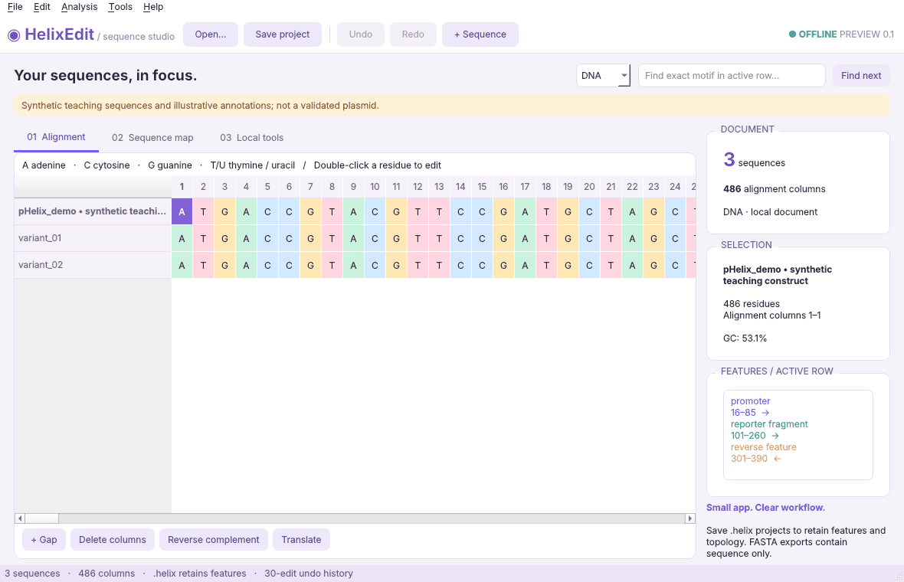

# HelixEdit

**A compact, colourful, offline sequence studio for Ubuntu x86_64/ARM64 and macOS Apple Silicon.**

Original C++17 / Qt 6 implementation inspired by BioEdit's practical editing workflow and the visual clarity of modern sequence-map tools. Independent of BioEdit and SnapGene; no original code or proprietary assets are included.

**Status: 0.2.1 beta source on `main` (native build/CI verification pending).** This refinement introduces an icon-only 56-pixel workspace rail, a persisted sidebar shortcut and more visible, sequence-coordinate-based plasmid feature rendering.




## New in 0.2.1 beta — icon-first sidebar and saturated plasmid features

**Compact ChatGPT-style navigation:** The left workspace activity rail is now **56 px wide**, with **icons only** for Sequence, Plasmid, and Analysis, and descriptive tooltips and accessible names. A top-rail arrow button shows or hides the secondary tools sidebar. The shortcut **Ctrl+Shift+S** and **View → Tools sidebar** control the same state; **Settings → Appearance → Show context tools sidebar on startup** saves the preference. The rail stays visible when the tools panel is hidden. The separate project explorer can still be toggled with **Ctrl+Shift+E**.

**Accurate, vivid circular feature tracks:** The Map canvas draws thick, saturated feature arcs on concentric lanes and orientation-aware arrowheads. Colors are based on the **actual imported or manually entered feature type/name** (purple promoters, gold origins, teal coding genes, coral terminators, pink primers, cyan regulatory features); unidentified types receive a distinct fallback color. Short features appear as dots at their genuine midpoint rather than enlarged fake intervals. The renderer uses **zero-based, half-open feature coordinates** from the active sequence and never invents annotations. Map → **Features** must be enabled; unannotated FASTA files need source-matched GenBank feature annotations to display biological regions.

**Scientific validation:** Added GUI tests for icon-only navigation, live menu/shortcut/sidebar synchronization, persisted settings, colored arcs at known circular coordinates, and disappearance of arcs when annotations are cleared. See [0.2.1 source notes](docs/GUI_021.md). Full Ubuntu compilation and rendered-map verification are still required.

### Build and install from your existing Ubuntu checkout

```bash
cd ~/Downloads/v3/HelixEdit
git pull --ff-only origin main
bash scripts/build_ubuntu_deb.sh
bash scripts/install_ubuntu_deb.sh
```

Expected package: `build-ubuntu-amd64/HelixEdit-0.2.1-x86_64.deb`. The installer safely stages the Debian package for APT's restricted `_apt` user.

## New in 0.2.0 beta — HelixEdit Glass Studio

**A (navigation):** The former top Sequence / Plasmid / Analysis ribbon is replaced by a narrow **left activity rail** with saturated blue, violet and emerald icon tiles. Each mode activates a scrollable, workspace-specific tool panel. These panels expose **the existing menu actions**, rather than implementing duplicate scientific commands.

- **Sequence** (cyan): Sequence viewer, Add, Rename, Remove, Insert Gap, Reverse Complement, Translate and Find ORFs.
- **Plasmid** (violet): Map, Enzymes, Features and Primers views, plus Addgene search/import, restriction analysis, annotated GenBank export and overlap assembly.
- **Analysis** (emerald): Local Tools and History views, MAFFT, MUSCLE 5, local BLAST+, Consensus, Identity Matrix, p-distance, Statistics and PHYLIP.
- **Canvas-first design:** the seven existing scientific pages remain intact but are accessed from the left panel; their redundant upper tab bar is hidden. The project explorer can be shown/hidden with the lower activity button (**Ctrl+Shift+E**), and the tools panel can also collapse. The initial Plasmid workspace hides the project explorer to maximize map width.
- **Shared command behavior:** Actions and shortcuts still use the original File, View, Edit, Analysis, Cloning and Tools menu entries. The status bar retains any scientific validation notices.

**B (appearance):** All three themes (Light, Dark and Dracula) gain saturated workspace accents, gradient-backed icon tiles, rounded 15–19 px rail/panel corners, alpha-blended translucent surfaces, bright active-mode outlines and readable hover/focus states. The native purple/teal HelixEdit application icon remains unchanged. This is **glass-inspired rendering in Qt Widgets**, not compositor background blur.

The beta is independent of BioEdit and SnapGene and must not be assumed scientifically validated solely from its interface. See [0.2 UI architecture and test notes](docs/GUI_020.md).

### Update the existing Ubuntu source installation

```bash
cd ~/Downloads/v3/HelixEdit
git pull --ff-only origin main
bash scripts/build_ubuntu_deb.sh
bash scripts/install_ubuntu_deb.sh
```

The helper installs the versioned `HelixEdit-0.2.1-x86_64.deb` without exposing your source directory to the APT sandbox. **Do not** prefix the helper with `sudo`; it obtains permission only for the system install.

## New in 0.1.9: sandbox-friendly Ubuntu DEB installation

An Ubuntu 26.04 installation log showed **successful installation of HelixEdit 0.1.8**, followed by the informational APT notice: `Download is performed unsandboxed as root ... couldn't be accessed by user '_apt'` (`pkgAcquire::Run (13: Permission denied)`). This happens when the restricted `_apt` account cannot traverse a private path under `~/Downloads`; it **does not mean the HelixEdit package failed to install**.

**Fixed installation workflow:** run `bash scripts/install_ubuntu_deb.sh` from the Git checkout after building. This helper verifies the package name and architecture, copies the .deb into a securely created, world-readable **temporary directory under /tmp** with 0755/0644 access, installs through `sudo apt-get`, and automatically deletes the temporary package. It never changes permissions on your home folder or project and does not disable the APT sandbox. The **in-app GitHub updater** now uses the same staging helper before its `pkexec` installation request.

The build script includes an unprivileged, mocked-APT test of the staging permissions and cleanup, and the CI workflow syntax-checks both new shell scripts. The first upgrade from an older version may need a terminal install using this helper; after installing 0.1.9 the in-app updater uses the new workflow.

**Standard Ubuntu commands:**

```bash
cd ~/Downloads/v3/HelixEdit
git pull --ff-only origin main
bash scripts/build_ubuntu_deb.sh
bash scripts/install_ubuntu_deb.sh
```

No `sudo` is needed before the final install step handled inside the helper. See [Debian installation notes](docs/INSTALL_019.md).

## New in 0.1.8: compact scientific workspace and redesigned About

The light-theme screenshots showed three sources of wasted vertical space: a tall toolbar, a duplicate command strip and a persistent cream-colored document-warning banner. The **0.1.8 layout reclaims these areas** for the Sequence and Map workspaces.

- **Compact icon-first toolbar:** Open, Save, Undo, Redo, Copy/Paste FASTA, Examples and Add Sequence remain available, with descriptive tooltips. Molecule type and **Find motif** now share this top row rather than occupying another full row. Settings and Update stay accessible from the toolbar and menus.
- **Smaller contextual ribbon:** Sequence, Plasmid and Analysis action tabs are reduced to a compact height; all buttons retain their original menu actions and shortcuts.
- **No milky notification banner:** scientific FASTA/GenBank notices are not lost. Their count and complete tooltip now live in the **status bar**, and the complete text is accessible through **Help → Document notices…**.
- **More canvas space:** the redundant bottom action-button row was removed from the Sequence view. Its operations remain in Edit/Analysis menus and in the editable grid's right-click context menu. The central tabbed workspace expands to use the reclaimed height.
- **Creative About dialog:** **Help → About HelixEdit** now displays the **same purple/teal SVG application icon** as the window/launcher, a gradient hero, a live version badge, feature focus, **Developed and edited by Wael H**, [waelye@gmail.com](mailto:waelye@gmail.com), and [github.com/mac860/HelixEdit](https://github.com/mac860/HelixEdit). Its **Open GitHub** and **Copy repository link** actions are functional. It retains the independent-beta scientific validation notice.

**Validation:** GUI tests cover compact toolbar controls, the absence of a central warning strip, and the About dialog icon, contributor links and copy operation. A fresh Ubuntu 26.04 build/CTest run is still required. [0.1.8 visual change notes](docs/GUI_018.md).

## New in 0.1.7: corrected GenBank / FASTA import

The attached Addgene #10878 GenBank file (`addgene-plasmid-10878-sequence-438456.gbk`) exposed an import bug: the parser split records at **every** `//`, including `https://www.snapgene.com` in a COMMENT line. This cut off the `ORIGIN` sequence and incorrectly produced *"Invalid or empty sequence"*.

**Fixed on `main`:** GenBank records terminate only at standalone `//` lines. The parser now preserves source labels written as `/label=AmpR` or `/label=AmpR promoter`, as well as quoted labels. UTF-8 BOMs are handled, and FASTA files can begin with blank/comment lines. Invalid FASTA messages now identify the record and offending character instead of giving only a generic error.

The supplied Addgene GenBank file declares **8,901 bp circular DNA** and contains **42 feature location entries**. The present HelixEdit simple-interval importer can represent **40** of these feature intervals; the two joined-location annotations are **skipped with warnings**, not silently converted into invalid continuous features. Imported annotations need independent biological verification before research use.

**Open annotated sequences:** choose **File → Open…**, then the downloaded `.gbk` / `.gb` file. HelixEdit should show 8,901 bp, circular topology, and the imported feature labels in Map/Features. If you instead open a **FASTA** of the same plasmid, the nucleotide sequence imports without GenBank annotation metadata; use the sequence-matched GenBank feature-import action to attach labels.

Run the updated [core import regression tests](tests/core_tests.cpp) with `bash scripts/build_ubuntu_deb.sh`. See [import fix and scientific limitations](docs/IMPORT_017.md).

## New in 0.1.6: sequence-correct circular plasmid maps

**Scientific reference:** [Addgene pLKO.1 – TRC cloning vector #10878](https://www.addgene.org/10878/sequences/) and [its sequence analyzer](https://www.addgene.org/browse/sequence/438456/). Addgene's plasmid maps may incorporate annotated GenBank features; HelixEdit must not invent those labels simply because a DNA string contains plausible-looking motifs.

- **No stale map after import:** Edit → Paste new FASTA records selects the first newly pasted record automatically. File → New document from FASTA clipboard… (Ctrl+Shift+V) opens copied Addgene sequence as a standalone document. Addgene GenBank imports likewise activate the newly imported plasmid.
- **Live sequence-based recognition sites:** the circular and linear views recalculate exact sites from the active record after every sequence change. The recognized catalog now contains **26 curated palindromic motifs** (from NEB's recognition list), versus eight previously. The interface shows **recognition starts, not cleavage positions**, and makes no methylation or experimental digest claims.
- **Confirm topology:** FASTA does not encode circular/linear topology. In the Map tab, set **Circular DNA** only when the source record confirms it. The state is retained in native \`.helix\` projects; annotated GenBank imports can carry topology directly.
- **Source-validated annotations:** File → **Attach matching GenBank annotations to active sequence…** or Features → **Import matching GenBank annotations…** transfers only supported simple-interval features when the **entire ungapped sequence is identical in the same origin and strand orientation**. No sequence match → no labels imported. If a donor differs because of rotation, reverse complementation, variation or partial sequence coverage, transfer is intentionally rejected. This is safer than guessing coordinates.
- **Actual annotated ring:** colored strand-aware arrows for imported/manual feature intervals, callout names with real coordinates, sequence-derived restriction-site leaders, and collision-limited labels. Unannotated records are explicitly identified as such.
- **Review sites:** Map → **Unique sites** shows enzymes with exactly one recognized occurrence, while the **Enzymes** tab lists all sites. Settings → Map & editing exposes this preference.
- **Dynamic information:** Map title shows the active record's real length, topology, annotation count and current recognition-site count. If a sequence base changes, motif sites disappear or appear on the next redraw, rather than remaining fixed from earlier data.

To try the supplied Addgene \`>Addgene_NGS_Result\` sequence, import it into a DNA project as FASTA, open **Map**, check the app's reported nucleotide count against the **specific** verified Addgene record, and explicitly enable **Circular DNA** if confirmed. To display promoters, origins, marker genes and primer annotations, download the **annotated GenBank** for the same exact sequence (if accessible with your Addgene account) and attach it to that record. Alternatively open the annotated GenBank directly. A raw FASTA sequence alone does **not** validate the gene identities or their coordinates. Note that this limited importer does not yet preserve complex \`join()\` feature locations or arbitrary GenBank metadata.

See [scientific map validation and limits](docs/GUI_016.md). **This is not a claim that the full user-pasted Addgene sequence has been verified base-for-base against Addgene.**

## New in 0.1.5: Wrap to Window in Sequence

The **Sequence** tab now offers a responsive, SnapGene-style **Wrap to Window** option (an independent HelixEdit implementation; no SnapGene code or assets). It reflows the **active sequence** into as many blocks as fit the available editor width, recalculating the bases-per-line when the window or sidebar is resized.

- **Wrap to Window** (on by default for new settings): shows one active DNA, RNA, or protein sequence in compact, vertically scrolling blocks with 10-base grouping, coordinate ruler, 5′/3′ labels, and colored residues.
- **Complementary strand** (DNA/RNA only): displays the **aligned** 3′→5′ complement beneath the 5′→3′ primary strand. This is display-only, not an exported reverse complement.
- **Feature tracks**: draws directional, colored annotation arrows across wrapped blocks; complete coordinates and metadata remain available in the Features panel.
- **Click a base** to select its original alignment column; **double-click** to switch to the original editable **Grid** at that position. The underlying sequence, annotations, and undo history do not change when switching views.
- **Wrap off** returns to the original multi-record, editable alignment grid. For DNA/RNA and protein, all alignment and analysis commands continue to operate on the underlying data.

You can also toggle the same mode through **View → Wrap to Window** (**Ctrl+Shift+W**). The controls also appear in **Settings → Preferences → Map & editing** and persist as `sequence/wrapToWindow`, `sequence/showComplement`, and `sequence/showFeatures`. For short sequences, only one wrapped block is needed. This initial implementation is a read-only visualization; it does not perform annotation editing or multi-sequence alignment editing inside the wrapped canvas. [Implementation and test notes](docs/GUI_015.md).

## New in 0.1.4: Visual examples, icon & automatic source discovery

- **Readable examples:** Removed legacy `gi|...` strings and long metadata from bundled FASTA names while keeping verified EMBL/UniProt accession identifiers. These orchid fragments are established **historical teaching data**, not newly published samples; see [example provenance and limitations](examples/samples/README.md).
- **Visual sequence workspace:** Opening DNA, simulated RNA or protein teaching collections now selects the colored **Sequence** tab automatically. A new **base/amino-acid composition chart** visualizes the selected record, and Analysis → Sequence statistics provides a table with colorful GC% bars and copyable TSV results. Ordinary FASTA text remains a plain scientific interchange format.
- **Updated source, by default:** Update and Settings use the currently saved Git checkout or try to find a nearby HelixEdit clone automatically (including common Downloads subfolders). The source updater is deliberately restricted to the existing official `mac860/HelixEdit` repository on `main`; it does not clone another repository or schedule background work. If the checkout is elsewhere, select it once.
- **Return of the DNA icon:** The original purple/teal HelixEdit SVG is rendered as the window/toolbar icon, installed under standard hicolor and pixmaps locations, and matched to GNOME/Wayland's desktop file. The Debian post-install script refreshes desktop and icon caches, so HelixEdit should appear in Ubuntu's application launcher after installation.
- **Vibrant Light theme:** blue-lilac layered gradients, aqua accents, softly translucent rounded panels, a subtle sidebar shadow, and rounded plasmid maps. This is **glass-inspired styling**, not operating-system background blur.
- **Package safeguards:** the build script checks the exact current DEB for executable, launcher, both icon installations, bundled examples, and source updater.

See [the 0.1.4 GUI change notes](docs/GUI_014.md).

## New in 0.1.2: Compact HelixEdit Studio

The interface uses a compact top toolbar, left searchable sequence navigator, and map-first tabs: **Map, Sequence, Enzymes, Features, Primers, History and Tools**. Circular and linear maps draw readable colored annotations and exact enzyme recognition positions. Map layers and zoom are adjustable; undo, primer library and reproducibility logs are functional. Appearance settings include **Light, Dark and Dracula**.

The built-in enzyme catalog remains a 26-motif scientific preview, not a full digest simulator. Primer3 and other scientific engines require their own optional installations. See [GUI design, functionality and validation notes](docs/GUI_012.md).

## Settings & preferences (0.1.3 beta)

Open **Settings → Preferences…** or use the **Settings** button in the toolbar (**Ctrl+,**). The former Appearance menu has been removed; related configuration is now gathered in one place:

- **Appearance:** choose Light, Dark or Dracula, and the default document view (Map or Sequence).
- **Map & editing:** visibility of enzyme labels and annotated features; initial map zoom; local autosave interval (30 seconds, 1, 2 or 5 minutes).
- **Scientific tools:** optional executable paths for MAFFT, MUSCLE, BLASTN, BLASTP and Primer3. Leave entries blank to search PATH. Primer3 now honors the configured executable path.
- **Updates:** choose and remember the existing Git source checkout for in-app, user-initiated updates. There are no periodic background update checks.

Press **Save settings** to apply. **Restore defaults** fills the default values so they can be reviewed before saving; **Cancel** keeps the previous settings. Preferences are stored locally with Qt QSettings and do not modify sequence data.

### About and maintainer

**Help → About HelixEdit** displays the application version, repository and developer attribution:

**Developed and edited by Wael H** · [waelye@gmail.com](mailto:waelye@gmail.com) · [HelixEdit GitHub repository](https://github.com/mac860/HelixEdit).

## 0.1.4: Update from the existing GitHub source

After installing **HelixEdit 0.1.4 or later**, click **Update** in the toolbar, **Settings → Update from GitHub source…**, or **Settings → Preferences… → Updates**. The app first tries your **existing HelixEdit Git clone** (for example `~/Downloads/v3/HelixEdit`) automatically. If it cannot locate the source, select its folder once; the location is remembered. The app offers two operations:

1. **Check GitHub:** fetches the remote `main` state and lists new commits; does not change your local files or installed package.
2. **Update, test & install:** after confirmation, fast-forwards the clean source checkout to the official GitHub `main`, compiles the native Qt application, runs CTest, builds a versioned `.deb`, and requests Ubuntu authentication through `pkexec` for a local package upgrade. Restart HelixEdit to load the update.

The update process **does not run in the background**, does not discard local edits, and never compiles as root. Network access is needed for GitHub checks; the app does not upload sequence data. If an old installation lacks the updater, upgrade **once** using the commands in the Ubuntu build section below. If `pkexec` is missing, it leaves the built DEB and prints a manual installation command. On macOS, update through your source checkout and rebuild until a separate signed macOS updater is implemented. See [Updater details and limitations](docs/GUI_013.md).

From a terminal, the equivalent commands are:

```bash
cd ~/Downloads/v3/HelixEdit
bash scripts/update_from_source.sh "$(pwd)" --check
bash scripts/update_from_source.sh "$(pwd)" --apply
```

## 0.1.4: 14 offline teaching examples

Choose **File → Open teaching examples** (or **Examples** in the compact toolbar). Three ready-to-edit FASTA collections are packaged and embedded in the application:

| Collection | Contents | Length | Reference/provenance |
|---|---|---:|---|
| DNA | 6 orchid ITS/5.8S DNA fragments | 300 nt each | Biopython `ls_orchid.fasta` with short EMBL accession-based labels |
| RNA | 3 **simulated** RNA transcriptions (T→U) of public orchid DNA fragments | 300 nt each | Biopython source DNA; not experimentally verified mature transcripts |
| Protein | 5 UniProt entries: GFP, insulin precursor, alpha/beta hemoglobin, E. coli aspartate aminotransferase | 110–396 aa | UniProtKB accessions in FASTA headers |

All records are shorter than 400 sequence characters, load without internet access, and are suitable for interface and import practice. The protein set is not a homologous alignment; do not infer phylogeny from it. See [sequence sources and reuse notes](examples/samples/README.md).

## Three scientific workspaces (development roadmap)

HelixEdit is being developed around three connected, offline-first workspaces. The capabilities below combine existing 0.1.x tools with **planned enhancements**, not a claim that all are already available.

| Workspace | Focus | Roadmap |
|---|---|---|
| **Sequence Studio** | Multiple-sequence alignment, accessible residue coloring, DNA/protein translation, six-frame ORF discovery, primer mapping and annotation editing | [Detailed specification](ROADMAP.md#1-sequence-studio--alignment-translation-and-sequence-editing) |
| **Plasmid Studio** | Interactive circular/linear maps, restriction analysis, cloning simulations, rich GenBank compatibility, primer binding sites and feature tracks | [Detailed specification](ROADMAP.md#2-plasmid-studio--maps-restriction-analysis-and-cloning) |
| **Analysis Studio** | Optional local MAFFT, MUSCLE and BLAST+ tools, sequence statistics, distance matrices and later phylogenetic inference | [Detailed specification](ROADMAP.md#3-analysis-studio--reproducible-local-bioinformatics) |

The full [scientific development roadmap](ROADMAP.md) defines user workflows, acceptance criteria, testing requirements and staged releases. Existing alignment, six-frame ORF finding, exact-overlap previews and local BLAST+ support are available as limited development workflows; richer cloning models, complex annotated GenBank round-trips and in-app phylogenetic inference remain planned.

## Academic workflow development — current main branch

Recent source commits add **annotated GenBank export** (simple interval features, nucleotide sequence and topology), an **aligned pairwise identity matrix**, and **exact-overlap two-fragment assembly previews** with optional circularization. They are exposed through File/Cloning/Analysis menus and the Plasmid/Analysis ribbon. A new `academic_workflows` Qt test target covers representative cases.

**Important:** These commits are not yet verified on all target platforms; they should not be treated as a published release or a validated molecular-cloning simulator. GenBank export deliberately handles only simple feature locations and does not preserve arbitrary GenBank metadata. Exact overlap is not a prediction of Gibson, Golden Gate, ligation, PCR or transformation success. The matrix compares aligned columns and excludes gap-containing pairs.

**Licensing:** HelixEdit contains independent implementation code, not copied proprietary SnapGene code or unverified BioEdit code. Feature parity is a development objective, not a current claim.

## Analysis Studio integration update (main; build verification pending)

- **Multiple sequence alignment:** MAFFT and MUSCLE 5 already support DNA and protein projects with two or more records, preserving original identifiers and annotations on validated output.
- **BLAST+:** local `blastn` and `blastp` queries against an existing `makeblastdb` database. Select a local database prefix; HelixEdit never sends queries to an online BLAST service. The first implementation is a 60-second synchronous preview and may temporarily block the UI. Database indexing and remote BLAST are not implemented.
- **Statistics:** alignment length, ungapped length, gap count, ambiguity count and nucleotide GC%.
- **Distance:** uncorrected pairwise p-distance matrix (no evolutionary correction; ambiguous letters are compared literally) and the previously added aligned identity matrix.
- **Phylogenetic interoperability:** strict sequential PHYLIP export with stable generated identifiers; no tree inference or bootstrap support yet. Keep the .helix project to preserve original labels.
- **Reproducibility:** alignment and BLAST+ jobs append UTC timestamps, executable/arguments, query SHA256 and output to a local `analysis-history.log`. Access it through Tools → View reproducible analysis history. The history is local and not tamper-evident; it is not a formal provenance system.
- **CI:** Ubuntu x86_64, Ubuntu ARM64 and macOS Apple Silicon workflows now install BLAST+ and run `scripts/integration_smoke.sh` for MAFFT, MUSCLE 5 and local nucleotide BLAST+. The new tests must pass before describing these integrations as verified.

**Branch audit:** Both `feature/sequence-studio-improvements` and `feature/0.1.1-themes` are already ancestors of `main` (ahead by zero commits); no merge was required and merging stale copies would risk reverting newer changes.

## Available now

- Pastel nucleotide colours and grouped amino-acid colours, compact workspace, alignment/map/tools tabs.
- On-demand alignment table with cell editing, rectangular selection, gap insertion, column deletion, FASTA block copy/paste, renaming, sequence removal and reverse complement.
- Linear and circular maps, directional features, annotation addition, clickable feature-to-alignment selection, vector SVG export.
- FASTA, CLUSTAL and limited GenBank import; FASTA and CLUSTAL export.
- Atomic `.helix` projects retain sequences, molecule type, topology and supported features.
- 30-change undo/redo, unsaved-change prompts, 30-second autosave and interrupted-session recovery.
- Standard-code translation, majority consensus, aligned identity, canonical-base GC and four common restriction motifs.
- Local asynchronous MAFFT 7 and MUSCLE 5 adapters with stable sequence IDs, input/output validation and undoable results.
- Optional Biopython conversion script; no Python runtime is needed by the desktop app.

## Build a native Ubuntu 26.04 x86_64 .deb

From the **repository root** (the directory containing `CMakeLists.txt`):

```bash
sudo apt update
sudo apt install -y git build-essential cmake ninja-build pkg-config \
  qt6-base-dev qt6-svg-dev dpkg-dev
git pull --ff-only origin main
bash scripts/build_ubuntu_deb.sh
```

The script creates a fresh architecture-specific directory such as `build-ubuntu-amd64`, compiles the app and test binaries, runs CTest in Qt offscreen mode, and creates a versioned `HelixEdit-0.2.1-x86_64.deb` (exact filename depends on the CMake architecture). Build logs are saved under `build-logs/`.

Install the generated package through the sandbox-friendly installer:

```bash
bash scripts/install_ubuntu_deb.sh
helixedit
```

An explicit package path is also supported: `bash scripts/install_ubuntu_deb.sh ./build-ubuntu-amd64/HelixEdit-0.2.1-x86_64.deb`. Avoid invoking `sudo` on the helper itself: it builds a temporary APT-readable copy as your normal user and asks for sudo only when installing.

**If a build fails**, copy the first `error:` message and the final 50 lines from the newest `build-logs/build-amd64-*.log` file. Do not run CMake with `sudo`, reuse an old CMake cache from a different Qt version, or run `cpack` before compilation completes.

For manual builds:

```bash
cmake -S . -B build-ubuntu-amd64 -G Ninja -DCMAKE_BUILD_TYPE=Release -DCMAKE_INSTALL_PREFIX=/usr
cmake --build build-ubuntu-amd64 --parallel 2
QT_QPA_PLATFORM=offscreen ctest --test-dir build-ubuntu-amd64 --output-on-failure
(cd build-ubuntu-amd64 && cpack -G DEB)
```

The native `.deb` uses the Ubuntu distribution's Qt libraries rather than bundling Qt. MAFFT, MUSCLE, BLAST+ and Primer3 are optional external scientific tools, not mandatory build dependencies.

## Build on Mac M1 / M2 / M3 / M4

Install Apple's Command Line Tools and Homebrew first, then use native ARM Homebrew:

```bash
brew install cmake qt
cmake -S . -B build -DCMAKE_BUILD_TYPE=Release \
  -DCMAKE_PREFIX_PATH="$(brew --prefix qt)" \
  -DCMAKE_OSX_ARCHITECTURES=arm64
cmake --build build --parallel 2
QT_QPA_PLATFORM=offscreen ctest --test-dir build --output-on-failure
open build/helixedit.app
```

For a self-contained Qt bundle:

```bash
"$(brew --prefix qt)/bin/macdeployqt" build/helixedit.app
```

The included workflow bundles Qt, ad-hoc signs the app and uploads a ZIP. It is **not Apple Developer ID signed or notarized**. Release distribution will require a signing identity and notarization. The minimum macOS version depends on the Qt package used; check Qt's supported-platform page before building for an older macOS.

## Start a session

1. Launch the app; the initial circular construct is explicitly synthetic teaching data.
2. Open `examples/alignment.fasta`, `examples/protein.fasta` or `examples/teaching_construct.gb`.
3. Verify the DNA/RNA/Protein selector. Character-based detection cannot distinguish all short proteins.
4. Double-click a residue to replace it. Select a rectangular region for gap operations; row headers select rows. Reverse complement acts on selected rows.
5. Use **Sequence map → + Feature** for ungapped, 1-based inclusive coordinates. Feature labels in the side panel select the matching alignment region.
6. Save a `.helix` project. Sequence-only exports intentionally omit features and topology.

Translation uses the entire active row, rejects gaps, uses the standard code and omits incomplete trailing codons. Find searches exact symbols in the active row; it does not interpret IUPAC wildcards or wrap across a circular origin. See [scientific rules and limitations](docs/ARCHITECTURE.md) before interpreting results.

## Modern packages, optional

```bash
# Ubuntu; availability and architecture support depend on your repositories
sudo apt install mafft muscle ncbi-blast+

# macOS; use native ARM packages
brew install mafft blast
brew install brewsci/bio/muscle
```

On Linux ARM64, the Ubuntu 24.04 MUSCLE 5.1 package failed the integration check while MAFFT passed. Upstream documents a missing `__aarch64__` pointer-width check. For a pinned MUSCLE 5.3 source build with that platform fix:

```bash
bash scripts/build_muscle_arm64.sh "$HOME/.local"
```

This helper downloads official upstream source and a checksum-verified build generator, compiles for ARM64 and installs only in the requested prefix. MAFFT remains the simplest default on ARM64.

Open **Tools → Configure executables** to supply paths if PATH discovery fails. On Apple Silicon, `/opt/homebrew/bin` is checked for alignment executables. MUSCLE must be version 5; the old MUSCLE 3 command syntax is not used. BLAST+ has path configuration only in this version; a search UI is planned. Third-party programs are not bundled, automatically downloaded or installed.

For sequence-only import from additional formats:

```bash
python3 -m venv .venv
source .venv/bin/activate
python -m pip install -r scripts/requirements.txt
python scripts/convert_sequences.py sample.ab1 sample.fasta --input-format abi
python scripts/convert_sequences.py sample.dna sample.fasta --input-format snapgene
python scripts/convert_sequences.py alignment.phy alignment.fasta --input-format phylip
```

The converter never overwrites an existing output. Keep original files: traces, quality values, annotations and topology are omitted from FASTA.

## Build artifacts

Verified preview packages from [build run 44783359673](https://github.com/mac860/HelixEdit/actions/runs/44783359673):

| Platform | Download | Verification |
|---|---|---|
| Ubuntu ARM64 | [ARM64 artifact ZIP](https://github.com/mac860/HelixEdit/actions/runs/44783359673/artifacts/14653216507) | Native build, tests, rendering and packaging passed |
| Ubuntu x86_64 | [x86_64 artifact ZIP](https://github.com/mac860/HelixEdit/actions/runs/44783359673/artifacts/14653331410) | Native build, tests, rendering and packaging passed |
| macOS Apple Silicon | See build run when its queued job completes | Not yet verified |

Extract the artifact ZIP, then install its `.deb` with `sudo apt install ./HelixEdit-*.deb`. The included images are interface previews. Artifacts expire under GitHub's retention policy; rebuild with the workflow if a download expires.


The **Build and test** GitHub Actions workflow builds Ubuntu x86_64, Ubuntu ARM64 and macOS ARM64 packages. Successful runs upload `.deb` files or a macOS app ZIP under the run's **Artifacts** section. Artifacts require GitHub sign-in for this private repository. ARM64 binaries are produced on ARM64 runners. CI artifacts are previews, not notarized releases.

## Current boundaries

No chromatogram viewer, BioEdit binary-project reader, direct `.dna` editor, rich GenBank round-trip, phylogenetic trees, molecular docking, multi-document workspace or alignment drag/slide yet. GenBank imports keep only simple feature locations and a few labels, with visible warnings for unsupported locations. The core remains small by leaving large analysis packages external. Actual memory and latency depend on dataset size; see the checked-in validation report for measured evidence.

## Development

```bash
QT_QPA_PLATFORM=offscreen ./build/helixedit --screenshot alignment.png
QT_QPA_PLATFORM=offscreen ./build/helixedit --screenshot map.png --map-preview
```

Automated tests cover all 64 standard codons, ambiguity/complement handling, parsers, coordinates, atomic project round-trips, aligned-output validation, editor undo/redo, gap edits, feature transforms and process-adapter acceptance/rejection. Fake aligners test adapter behaviour; they do not validate the scientific performance of MAFFT/MUSCLE.

[Architecture](docs/ARCHITECTURE.md) · [Sources](docs/SOURCES.md) · [Validation](docs/VALIDATION.md)

MIT license for HelixEdit's own code. Qt, Biopython and optional executables retain their respective licenses. Qt is dynamically linked; bundled distributions must preserve applicable notices and comply with Qt's licensing terms.

## 0.1.1 beta candidate

The Appearance menu offers Light, Dark and Dracula themes, persisted with Qt QSettings. This branch is a source candidate, not a published or independently tested release. Existing 0.1.0 CI artifacts remain 0.1.0; build and validate all target platforms before tagging 0.1.1.
