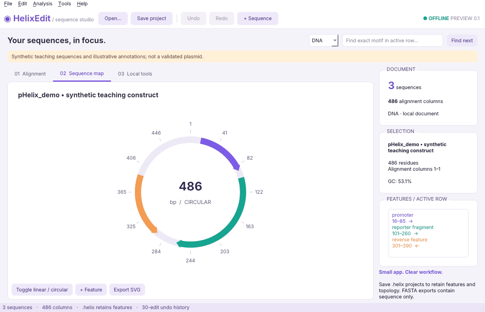

# HelixEdit

**A compact, colourful, offline sequence studio for macOS Apple Silicon and Ubuntu ARM64.**

Original C++17 / Qt 6 implementation inspired by BioEdit's practical editing workflow and the visual clarity of modern sequence-map tools. Independent of BioEdit and SnapGene; no original code or proprietary assets are included.

**Status: 0.1.1 beta candidate (not yet verified).** Local Linux x86_64 tests pass. Native Ubuntu 24.04 x86_64 and ARM64 CI builds, real-aligner integration tests, rendering and Debian packaging have also passed. The Apple Silicon build job is supplied but remains queued; macOS is not yet verified. Target-device desktop testing is still recommended. Full BioEdit feature parity is not claimed.




## Three scientific workspaces (development roadmap)

HelixEdit is being developed around three connected, offline-first workspaces. The capabilities below combine existing 0.1.x tools with **planned enhancements**, not a claim that all are already available.

| Workspace | Focus | Roadmap |
|---|---|---|
| **Sequence Studio** | Multiple-sequence alignment, accessible residue coloring, DNA/protein translation, six-frame ORF discovery, primer mapping and annotation editing | [Detailed specification](ROADMAP.md#1-sequence-studio--alignment-translation-and-sequence-editing) |
| **Plasmid Studio** | Interactive circular/linear maps, restriction analysis, cloning simulations, rich GenBank compatibility, primer binding sites and feature tracks | [Detailed specification](ROADMAP.md#2-plasmid-studio--maps-restriction-analysis-and-cloning) |
| **Analysis Studio** | Optional local MAFFT, MUSCLE and BLAST+ tools, sequence statistics, distance matrices and later phylogenetic inference | [Detailed specification](ROADMAP.md#3-analysis-studio--reproducible-local-bioinformatics) |

The full [scientific development roadmap](ROADMAP.md) defines user workflows, acceptance criteria, testing requirements and staged releases. Existing alignment and map functionality remains available; advanced ORF, cloning, BLAST UI and phylogenetics features are not yet shipped.

## Academic workflow development — current main branch

Recent source commits add **annotated GenBank export** (simple interval features, nucleotide sequence and topology), an **aligned pairwise identity matrix**, and **exact-overlap two-fragment assembly previews** with optional circularization. They are exposed through File/Cloning/Analysis menus and the Plasmid/Analysis ribbon. A new `academic_workflows` Qt test target covers representative cases.

**Important:** These commits are not yet verified on all target platforms; they should not be treated as a published release or a validated molecular-cloning simulator. GenBank export deliberately handles only simple feature locations and does not preserve arbitrary GenBank metadata. Exact overlap is not a prediction of Gibson, Golden Gate, ligation, PCR or transformation success. The matrix compares aligned columns and excludes gap-containing pairs.

**Licensing:** HelixEdit contains independent implementation code, not copied proprietary SnapGene code or unverified BioEdit code. Feature parity is a development objective, not a current claim.

## Available now

- Pastel nucleotide colours and grouped amino-acid colours, compact workspace, alignment/map/tools tabs.
- On-demand alignment table with cell editing, rectangular selection, gap insertion, column deletion, FASTA block copy/paste, renaming, sequence removal and reverse complement.
- Linear and circular maps, directional features, annotation addition, clickable feature-to-alignment selection, vector SVG export.
- FASTA, CLUSTAL and limited GenBank import; FASTA and CLUSTAL export.
- Atomic `.helix` projects retain sequences, molecule type, topology and supported features.
- 30-change undo/redo, unsaved-change prompts, 30-second autosave and interrupted-session recovery.
- Standard-code translation, majority consensus, aligned identity, canonical-base GC and four common restriction motifs.
- Local asynchronous MAFFT 7 and MUSCLE 5 adapters with stable sequence IDs, input/output validation and undoable results.
- Optional Biopython conversion script; no Python runtime is needed by the desktop app.

## Build on Ubuntu (ARM64 or x86_64)

Use packages for the architecture of the operating system you are running:

```bash
sudo apt update
sudo apt install build-essential cmake qt6-base-dev qt6-svg-dev dpkg-dev
cmake -S . -B build -DCMAKE_BUILD_TYPE=Release
cmake --build build --parallel 2
ctest --test-dir build --output-on-failure
./build/helixedit
```

To create an architecture-native Debian package:

```bash
(cd build && cpack -G DEB)
sudo apt install ./build/HelixEdit-*.deb
```

The `.deb` uses the distribution's Qt libraries; it does not bundle a browser, Python, alignment software or Qt itself. Package on the oldest Ubuntu release you intend to support. A package built on a newer release may require newer system libraries. The workflow builds on Ubuntu 24.04, including ARM64.

## Build on Mac M1 / M2 / M3 / M4

Install Apple's Command Line Tools and Homebrew first, then use native ARM Homebrew:

```bash
brew install cmake qt
cmake -S . -B build -DCMAKE_BUILD_TYPE=Release \
  -DCMAKE_PREFIX_PATH="$(brew --prefix qt)" \
  -DCMAKE_OSX_ARCHITECTURES=arm64
cmake --build build --parallel 2
QT_QPA_PLATFORM=offscreen ctest --test-dir build --output-on-failure
open build/helixedit.app
```

For a self-contained Qt bundle:

```bash
"$(brew --prefix qt)/bin/macdeployqt" build/helixedit.app
```

The included workflow bundles Qt, ad-hoc signs the app and uploads a ZIP. It is **not Apple Developer ID signed or notarized**. Release distribution will require a signing identity and notarization. The minimum macOS version depends on the Qt package used; check Qt's supported-platform page before building for an older macOS.

## Start a session

1. Launch the app; the initial circular construct is explicitly synthetic teaching data.
2. Open `examples/alignment.fasta`, `examples/protein.fasta` or `examples/teaching_construct.gb`.
3. Verify the DNA/RNA/Protein selector. Character-based detection cannot distinguish all short proteins.
4. Double-click a residue to replace it. Select a rectangular region for gap operations; row headers select rows. Reverse complement acts on selected rows.
5. Use **Sequence map → + Feature** for ungapped, 1-based inclusive coordinates. Feature labels in the side panel select the matching alignment region.
6. Save a `.helix` project. Sequence-only exports intentionally omit features and topology.

Translation uses the entire active row, rejects gaps, uses the standard code and omits incomplete trailing codons. Find searches exact symbols in the active row; it does not interpret IUPAC wildcards or wrap across a circular origin. See [scientific rules and limitations](docs/ARCHITECTURE.md) before interpreting results.

## Modern packages, optional

```bash
# Ubuntu; availability and architecture support depend on your repositories
sudo apt install mafft muscle ncbi-blast+

# macOS; use native ARM packages
brew install mafft blast
brew install brewsci/bio/muscle
```

On Linux ARM64, the Ubuntu 24.04 MUSCLE 5.1 package failed the integration check while MAFFT passed. Upstream documents a missing `__aarch64__` pointer-width check. For a pinned MUSCLE 5.3 source build with that platform fix:

```bash
bash scripts/build_muscle_arm64.sh "$HOME/.local"
```

This helper downloads official upstream source and a checksum-verified build generator, compiles for ARM64 and installs only in the requested prefix. MAFFT remains the simplest default on ARM64.

Open **Tools → Configure executables** to supply paths if PATH discovery fails. On Apple Silicon, `/opt/homebrew/bin` is checked for alignment executables. MUSCLE must be version 5; the old MUSCLE 3 command syntax is not used. BLAST+ has path configuration only in this version; a search UI is planned. Third-party programs are not bundled, automatically downloaded or installed.

For sequence-only import from additional formats:

```bash
python3 -m venv .venv
source .venv/bin/activate
python -m pip install -r scripts/requirements.txt
python scripts/convert_sequences.py sample.ab1 sample.fasta --input-format abi
python scripts/convert_sequences.py sample.dna sample.fasta --input-format snapgene
python scripts/convert_sequences.py alignment.phy alignment.fasta --input-format phylip
```

The converter never overwrites an existing output. Keep original files: traces, quality values, annotations and topology are omitted from FASTA.

## Build artifacts

Verified preview packages from [build run 44783359673](https://github.com/mac860/HelixEdit/actions/runs/44783359673):

| Platform | Download | Verification |
|---|---|---|
| Ubuntu ARM64 | [ARM64 artifact ZIP](https://github.com/mac860/HelixEdit/actions/runs/44783359673/artifacts/14653216507) | Native build, tests, rendering and packaging passed |
| Ubuntu x86_64 | [x86_64 artifact ZIP](https://github.com/mac860/HelixEdit/actions/runs/44783359673/artifacts/14653331410) | Native build, tests, rendering and packaging passed |
| macOS Apple Silicon | See build run when its queued job completes | Not yet verified |

Extract the artifact ZIP, then install its `.deb` with `sudo apt install ./HelixEdit-*.deb`. The included images are interface previews. Artifacts expire under GitHub's retention policy; rebuild with the workflow if a download expires.


The **Build and test** GitHub Actions workflow builds Ubuntu x86_64, Ubuntu ARM64 and macOS ARM64 packages. Successful runs upload `.deb` files or a macOS app ZIP under the run's **Artifacts** section. Artifacts require GitHub sign-in for this private repository. ARM64 binaries are produced on ARM64 runners. CI artifacts are previews, not notarized releases.

## Current boundaries

No chromatogram viewer, BioEdit binary-project reader, direct `.dna` editor, rich GenBank round-trip, phylogenetic trees, molecular docking, multi-document workspace or alignment drag/slide yet. GenBank imports keep only simple feature locations and a few labels, with visible warnings for unsupported locations. The core remains small by leaving large analysis packages external. Actual memory and latency depend on dataset size; see the checked-in validation report for measured evidence.

## Development

```bash
QT_QPA_PLATFORM=offscreen ./build/helixedit --screenshot alignment.png
QT_QPA_PLATFORM=offscreen ./build/helixedit --screenshot map.png --map-preview
```

Automated tests cover all 64 standard codons, ambiguity/complement handling, parsers, coordinates, atomic project round-trips, aligned-output validation, editor undo/redo, gap edits, feature transforms and process-adapter acceptance/rejection. Fake aligners test adapter behaviour; they do not validate the scientific performance of MAFFT/MUSCLE.

[Architecture](docs/ARCHITECTURE.md) · [Sources](docs/SOURCES.md) · [Validation](docs/VALIDATION.md)

MIT license for HelixEdit's own code. Qt, Biopython and optional executables retain their respective licenses. Qt is dynamically linked; bundled distributions must preserve applicable notices and comply with Qt's licensing terms.

## 0.1.1 beta candidate

The Appearance menu offers Light, Dark and Dracula themes, persisted with Qt QSettings. This branch is a source candidate, not a published or independently tested release. Existing 0.1.0 CI artifacts remain 0.1.0; build and validate all target platforms before tagging 0.1.1.
